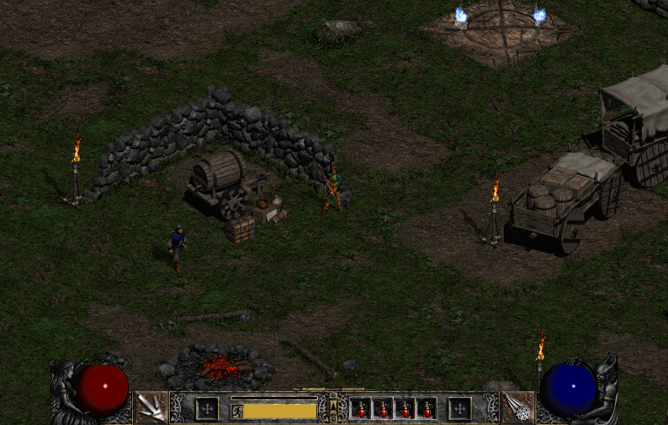

# D2Next

D2Next is a Diablo II game client for modern 64-bit systems. It loads user-supplied game assets and brings them to life with its own frontend, map and character rendering, game HUD, SDL input and audio, and desktop and mobile controls. The project has Windows, Linux, Android, and Web build paths, with Direct3D 11 and OpenGL ES / WebGL rendering. Native game sessions run inside the client through a 64-bit port of D2MOO's game libraries.

This repository does not include Diablo II assets, binaries, or copyrighted game data. It requires legally owned Diablo II 1.10f / Lord of Destruction MPQ archives supplied by the user at runtime.



*Act I Rogue Encampment, rendered from user-supplied Diablo II data.*

## What D2Next Adds

D2Next brings together the client, rendering, platform support, and native game integration:

- Built a client frontend with asset decoding, map and character rendering, game UI, SDL3 input and audio, and Direct3D 11 and OpenGL ES / WebGL renderers.
- Added build paths for Windows, Linux, Android, and the Web, including desktop SDL support and Android touch controls.
- Connected native game sessions and local character saves directly to the client.
- Ported D2MOO's game libraries to 64-bit, addressing pointer-size assumptions, exported ordinal checks, host integration, and compatibility issues.
- Built an Android APK pipeline using CMake, the Android NDK, SDL's Java activity, `aapt2`, `d8`, `zipalign`, and `apksigner`.
- Added an in-app Android document picker so user-owned Diablo II archives can stay in a shared folder (Documents/D2Next) without requiring access to the restricted `Android/data` folder.
- Implemented deterministic simulation and rendering test hooks for regression checks.
- Preserved a clean legal boundary: source code only, user-supplied game archives only.

## Current Status

The project is an active engine/client prototype. It can decode and render Diablo II assets, load maps, drive native game sessions, support local character saves, and build SDL/Android targets. It is not a commercial remake and is not a drop-in replacement for the original game.

Supported work areas include:

- MPQ asset loading through StormLib.
- DC6, DT1, DS1, DCC, COF, table, font, audio, and UI asset handling.
- Act I map rendering, tile inspection, character animation, collision overlays, and movement.
- Native D2MOO game logic rebuilt for 64-bit and linked into the modern client.
- SDL3 window/input/audio path for portable desktop, Linux, Android, and the web.
- Direct3D 11 renderer for Windows and OpenGL ES / WebGL 2 renderer for SDL, Linux, Android, and the browser.
- Android packaging for ARM64 devices.
- Immortal-inspired Android touch controls: joystick movement, attack and quick-cast skills, contextual pickup/talk,
  readable safe-area-aware NPC menus and dialogue, a host IP quick button for multiplayer, adjustable control layout,
  and touch-first inventory actions.

Known limitations:

- Gameplay coverage is still incomplete.
- Original game data must be supplied separately.
- Android support is build-oriented and still needs broader real-device validation.
- Linux and the Emscripten/WebGL 2 page are first build slices: playable with user MPQs, without a packaged distro or IDBFS save sync.
- Some UI, exact pathfinding parity, object behavior, roof hiding, and multiplayer polish remain future work.

## Repository Layout

```text
modern/                 Modern D2Next client, renderers, platform layers, Android files
modern/src/             Client state, frontend, input, rendering, audio, native bridge
modern/android/         APK build script, manifest, Android resources
modern/web/             Emscripten / WebGL 2 page (shell, build script)
modern/LINUX.md         Linux SDL + OpenGL ES build
modern/external/SDL/    Vendored SDL3 source
modern/external/StormLib/
                         Vendored StormLib source for MPQ access
source/                 D2MOO game library sources
external/               Supporting libraries and compatibility headers
external/win32compat/   Minimal Windows header compatibility for non-Windows builds
cmake/                  Shared CMake helpers
tools/x64/              Native host/test utilities and D2Net mock transport
MPQ/                    Runtime location for user-supplied game archives
Save/                   Runtime location for local character files
```

## Requirements

### Windows SDL Build

- Windows 10 or newer
- Visual Studio C++ toolchain
- CMake
- Vendored source dependencies in this repository
- User-supplied Diablo II 1.10f / Lord of Destruction MPQ archives for runtime

### Android Build

- Android SDK
- Android NDK `30.0.16248370`
- Android platform `android-36`
- Android build tools `36.1.0`
- Android CMake `4.1.2`
- JDK 11 or newer
- Bash-compatible shell

The Android script uses SDK tools directly and does not require Gradle or Android Studio.

## Build

### Windows SDL

```powershell
./Build-Modern-SDL.sh
```

Equivalent CMake flow:

```powershell
cmake -S modern -B out/modern-sdl -A x64 -DD2MODERN_PLATFORM=SDL
cmake --build out/modern-sdl --config Release --parallel 6
```

For OpenGL ES through SDL:

```powershell
cmake -S modern -B out/modern-sdl-gl -A x64 -DD2MODERN_PLATFORM=SDL -DD2MODERN_RENDERER=GL
cmake --build out/modern-sdl-gl --config Release --parallel 6
```

### Linux

```bash
./Build-Linux.sh
```

See [modern/LINUX.md](modern/LINUX.md). Docker on a machine without Linux packages:

```bash
docker run --rm -v "$PWD:/src" -w /src ubuntu:24.04 bash -lc 'D2MODERN_INSTALL_DEPS=1 ./Build-Linux.sh'
```

### Web (Emscripten / WebGL 2)

```bash
bash modern/web/build-web.sh
```

Then `Play-Web.cmd` (or `node modern/web/serve.js`) and open http://127.0.0.1:8060/D2Next.html. See [modern/web/README.md](modern/web/README.md).

### Android

```bash
bash modern/android/build-apk.sh
```

The script creates:

```text
out/android/D2Next.apk
```

Install with:

```bash
adb install -r out/android/D2Next.apk
```

## Runtime Data

The project does not ship with Diablo II data. Supply compatible archives from a legal local installation. On Android,
a launcher appears each time you open the app, before any archives are read. It is a checklist of the game folder,
required MPQs, saves, and view zoom. Tap Change for folder, zoom, and cheat settings. Choose a shared folder (suggested:
`Documents/D2Next`). D2Next creates `MPQ`, `Save`, and `Logs` there with `README.txt` files that list what to copy.
Place archives in `MPQ/` and character saves in `Save/`. Tap Launch to start. D2Next opens the archives from that
folder in place and mirrors saves, settings, and logs back every 10 seconds and when it exits. This avoids depending
on access to the restricted `Android/data` folder.

Common required files:

```text
d2data.mpq
d2exp.mpq
d2char.mpq
d2sfx.mpq
Patch_D2.mpq
```

Optional audio/video archives:

```text
d2speech.mpq
d2xtalk.mpq
d2music.mpq
d2xmusic.mpq
d2video.mpq
d2xvideo.mpq
```

On desktop, local character saves live in `Save/`. On Android, the selected shared folder has this layout:

```text
D2Next/
    MPQ/
    Save/
    d2next.log
    Logs/
```

## Verification

Useful checks during development:

```powershell
ctest --test-dir out/modern -C Release --output-on-failure
out/modern/Release/D2Next.exe --verify-assets
out/modern/Release/D2Next.exe --smoke-test
out/modern/Release/D2Next.exe --tiles --verify-assets
out/modern/Release/D2Next.exe --map --verify-assets
```

Some tests require user-supplied MPQ archives and compatible save files.

## Technical Highlights

### 32-Bit to 64-Bit D2MOO Modernization

D2MOO began as a reverse-engineered 32-bit Windows codebase matching the original Diablo II runtime. D2Next updates that code path so the important game-library stack can compile and run in a 64-bit process. This required separating original-client assumptions from reusable game logic, handling pointer-size-sensitive code, validating DLL exports and ordinals, replacing pieces that depended on original 32-bit process behavior, and adding compatibility switches for modern Windows and non-Windows toolchains.

The result is a 64-bit native game stack that can be used by the modern client without injecting into or replacing the original game executable.

### In-Process Native Game

D2MOO's `D2Game`, `D2Common`, `Fog`, `Storm`, `D2Lang`, `D2CMP`, and `D2Hell` sources are built as 64-bit static libraries and linked into the modern client. This avoids a separate game-host process for normal play and makes debugging the game loop easier.

### Portable Platform Layer

The client separates platform concerns behind `Platform.h`. Windows can use the Win32 path, while SDL3 supports portable desktop and Android builds. Audio, input, touch controls, and controller input are handled through the modern client layer.

### Renderer Split

Rendering is split between portable draw-list generation and backend-specific GPU implementations:

- `D3D11Backend.cpp` for Windows Direct3D 11.
- `GlBackend.cpp` for OpenGL ES / SDL / Android.

### Android Without Gradle

The Android build script compiles native code with CMake and the NDK, compiles SDL's Java activity with `javac` and `d8`, packages resources with `aapt2`, then aligns and signs the APK with SDK tools.

### Compatibility Headers

`external/win32compat` provides small header shims for non-Windows builds where D2MOO-era code still expects Windows types or headers. This is especially important for Android and other non-Windows toolchains.

## Project Goals

- Preserve D2MOO's research and modding value.
- Make the engine easier to build, test, and debug on modern systems.
- Move rendering, input, audio, and packaging toward portable targets.
- Keep the source-only repository clean and legally separate from proprietary game assets.

## Credits

D2Next builds on the D2MOO project and the work of the Phrozen Keep community. This project would not exist without the original reverse-engineering, documentation, and modding research contributed by that community.

The in-game credits append D2Next and its open-source dependencies after the credits read from the user's game archives. Third-party libraries are retained in `external/` and `modern/external/` with their respective licenses and notices.

## Legal

This repository is source code only. It does not provide Blizzard Entertainment game assets, original binaries, Battle.net functionality, copy protection bypasses, or piracy-related material.

Diablo and Diablo II are trademarks or registered trademarks of Blizzard Entertainment, Inc. D2Next is not affiliated with, endorsed by, or sponsored by Blizzard Entertainment.

Users are responsible for supplying their own legally obtained game data.
